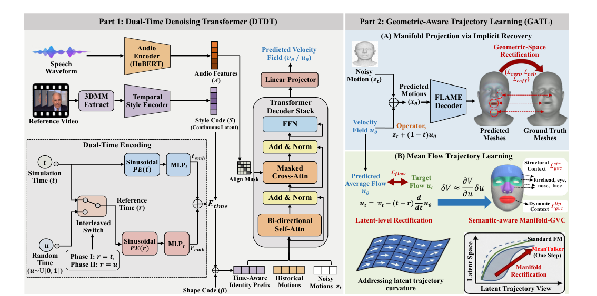
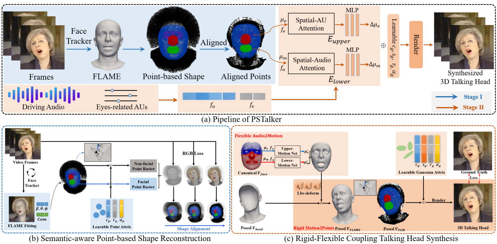
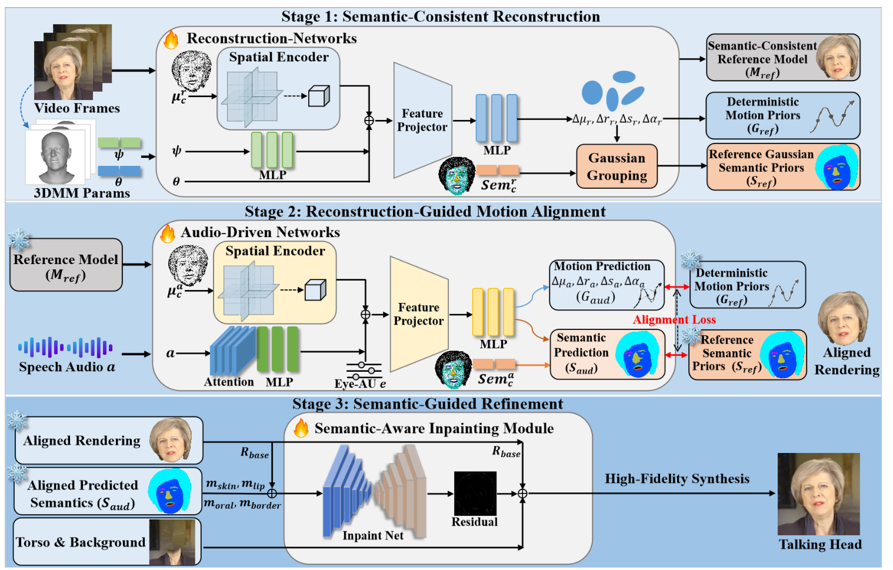

# Speech-Driven 3D Talking Head · 论文研究系列

> 系统梳理 **MeanTalker / PSTalker / SRP-Talker** 语音驱动 3D 数字人。


本系列围绕**语音驱动 3D 面部动画与数字人合成**，三项工作沿“**高效生成 → 几何可控 → 个性化真实感**”逐层递进：

| # | 论文 | 会议 | 核心问题 | 核心方案 | 关键结果 |
|---|------|------|----------|----------|----------|
| 1 | **MeanTalker** | ECCV | 扩散模型迭代采样慢，无法实时部署 | 基于 Mean Flow 的单步生成 + DTDT 双时间课程 + GATL 几何感知轨迹学习 | RTF **0.004**，NFE=1，较扩散模型加速 **200×+**，LVE 7.88 mm |
| 2 | **PSTalker** | ICASSP 2026 | 头-躯干接缝伪影、音唇错位、姿态不可控 | SAPS 语义感知点形状 + RFC 刚柔耦合（LBS） | 512×512 超 **30 FPS**，LMD 2.570，Sync-C 7.890，支持姿态控制 |
| 3 | **SRP-Talker** | ICME 2026 | 像素级监督不足导致个性化音唇错位与解耦伪影 | 语义一致重建先验 + 运动对齐 + 语义引导修复（三阶段） | **~31 FPS**，PSNR 31.887，Sync-C 8.106 逼近重建上限 8.150 |

```
MeanTalker (ECCV)                 PSTalker (ICASSP)                SRP-Talker (ICME)
高效运动生成                      几何可控建模                      个性化真实感
─────────────────                 ─────────────────                ─────────────────
Mean Flow 单步生成        →       点形状 + 刚柔耦合        →       重建先验 + 语义修复
解决“慢”                          解决“接缝/可控”                   解决“错位/伪影”
```

**共性技术底座**：HuBERT 音频特征 · FLAME 3D 形变模型 · 3D Gaussian Splatting · 语义感知建模。

---

## 1. MeanTalker（ECCV）

**MeanTalker: Efficient and Expressive Speech-Driven 3D Facial Animation via Geometric-Aware Mean Flow**

- **作者**：Zhongyuan Zhao, Zhihao Li, Qing Li, Leidong Fan, Kanglin Liu
- **通讯作者**： Kanglin Liu
- **机构**：School of Electronic and Computer Engineering, Peking University, Shenzhen；Pengcheng Laboratory



### 摘要

确定性回归模型难以处理语音到面部运动复杂的多对多映射，容易产生过度平滑的运动；而扩散模型虽能刻画富有表现力的分布，却因迭代采样带来显著延迟。MeanTalker 构建于 Mean Flow 之上，是一个单步语音到运动生成框架：双时间去噪 Transformer（DTDT）通过交错双时间编码支持从瞬时速度到平均速度的渐进式课程训练，保证训练稳定性；几何感知轨迹学习（GATL）通过隐式流形投影与双空间监督校正生成轨迹，将潜在速度误差投影到表面流形，严格约束流场方向，从而保证精确同步的单步合成。

### 核心方法

- **DTDT（Dual-Time Denoising Transformer 双时间去噪 Transformer）**：引入交错双时间编码（仿真时间 t 与参考时间 r），支持从瞬时速度到平均速度的渐进式课程学习，规避直接训练 Mean Flow 的不稳定性；掩码交叉注意力以对角对齐掩码强制音素-唇形逐帧同步。
- **GATL（Geometric-Aware Trajectory Learning 几何感知轨迹学习）**：通过隐式恢复解析预测干净端点并施加显式顶点约束，同时将潜在速度误差经 Manifold-GVC 投影到 FLAME 表面流形，对唇部等发音关键区域施加更强约束，保证流形有效与路径平直。

### 主要贡献

- 提出基于 Mean Flow 直接轨迹建模的高效框架，单步（NFE=1）生成，克服扩散模型的延迟瓶颈
- 设计双时间去噪 Transformer（DTDT），实现瞬时速度到平均速度场的渐进式建模
- 提出几何感知轨迹学习（GATL），融合隐式流形投影与语义感知轨迹校正，保证几何有效性与路径平直
- 在 TFHP 基准上取得 SOTA 唇形同步精度，推理速度较迭代扩散模型提升 200 倍以上

### 关键指标

| LVE 唇顶点误差 | RTF 实时率 | 推理加速 | MVE 全顶点误差 |
|---|---|---|---|
| **7.88 mm**（优于 MSMD 8.39） | **0.004**（NFE=1） | **>200×**（对比 DiffPoseTalk） | **0.79 mm**（5023 顶点平均） |

### 定量对比（TFHP 测试集，RTF 基于单张 RTX 3090）

| 方法 | 范式 | LVE↓ (mm) | FDD↓ (×10⁻⁵m) | MOD↓ (mm) | MVE↓ (mm) | RTF↓ |
|---|---|---|---|---|---|---|
| MultiTalk | Autoregressive | 11.099 | 8.348 | 3.853 | 1.494 | 0.288 |
| ScanTalk | Regression | 13.145 | 12.550 | 4.365 | 2.254 | 0.049 |
| DiffPoseTalk | Diffusion | 9.119 | 5.458 | 3.225 | 0.938 | 0.919 |
| ARTalk | Autoregressive | 11.783 | 12.049 | 4.057 | 1.643 | 0.020 |
| MSMD | Diffusion | 8.390 | 5.763 | 2.982 | 0.829 | 1.015 |
| **MeanTalker** | **Mean Flow** | **7.879** | **5.189** | **2.830** | **0.788** | **0.004** |

### 数据集

**TFHP**：1052 个高清视频片段、约 26.5 小时、588 个不同主体；460 主体训练 / 64 主体验证 / 64 个未见主体（120 片段、3.15 小时）测试，25 fps，提取 FLAME 参数。

---

## 2. PSTalker（ICASSP 2026）

**PSTalker: Realistic 3D Talking Head Synthesis via a Semantic-Aware Audio-Driven Point-Based Shape**

- **作者**：Zhongyuan Zhao, Qing Li, Kanglin Liu
-  **通讯作者**： Kanglin Liu
- **机构**：School of Electronic and Computer Engineering, Peking University；Pengcheng Laboratory
- **DOI**：[10.1109/ICASSP55912.2026.11463938](https://doi.org/10.1109/ICASSP55912.2026.11463938)



### 摘要

基于 NeRF 与 3DGS 的说话人头合成仍存在音唇错位、头-躯干接缝伪影与可控性不足等问题。PSTalker 构建语义感知点形状模型（SAPS）：在 FLAME 网格表面及沿法线方向的网格外进行语义采样，同时建模面部与非面部结构（含头部与躯干），避免头-躯干接缝伪影；进一步提出刚柔耦合模型（RFC），将高斯运动场与线性混合蒙皮（LBS）结合，使音频驱动的动态受结构化形变约束，增强运动稳定性与几何可编辑性。

### 核心方法

- **SAPS（Semantic-Aware Point-based Shape 语义感知点形状模型）**：基于 FLAME 按语义标签（眼、脸、颈、边界等）在网格表面及沿法线方向采样点，非面部点建模头发与躯干、面部点负责音频驱动形变，并新增牙齿三角面；以 analysis-by-synthesis 方式经点光栅化优化，剪枝低可见度点。
- **RFC（Rigid-Flexible Coupling 刚柔耦合模型）**：将顶点语义切分为音频驱动（唇部）与表情驱动（眼部）区域，面部顶点偏移在规范空间预测后经 LBS 变换，把柔性面部运动与刚性头部姿态显式耦合，再实例化为 3D 高斯进行高保真渲染。

### 主要贡献

- 提出语义感知点形状模型 SAPS，统一建模面部与非面部（含头、躯干）结构，消除头-躯干接缝伪影
- 设计刚柔耦合机制 RFC，将高自由度音频形变锚定到稳定几何先验，结合 LBS 增强稳定性与几何可编辑性
- 上下唇运动分离（ULS）与 FLAME 几何正则（GR）保障精确唇形同步
- 在自驱动与跨驱动设置下达到与 SOTA 相当/更优的性能，512×512 分辨率超 30 FPS，并支持以往方法不具备的灵活姿态控制

### 关键指标

| LMD 唇动距离 | Sync-C 同步置信度 | FID | 推理速度 |
|---|---|---|---|
| **2.570**（对比方法最低） | **7.890** | **8.178**（对比方法最低） | **>30 FPS**（RTX 3090，512×512） |

### 定量对比（自驱动 self-driven 设置）

| 方法 | PSNR↑ | LPIPS↓ | FID↓ | LMD↓ | AUE↓ | Sync-C↑ |
|---|---|---|---|---|---|---|
| ER-NeRF | 35.964 | 0.010 | 18.966 | 2.866 | 0.748 | 6.248 |
| GaussianTalker | 36.033 | 0.011 | 10.007 | 2.860 | 0.725 | 6.741 |
| TalkingGaussian | 36.866 | 0.009 | 11.338 | 2.639 | 0.419 | 7.500 |
| **PSTalker** | **36.649** | **0.010** | **8.178** | **2.570** | **0.365** | **7.890** |

### 数据集

**4 个高质量说话人像视频**：采集自既往 NeRF/高斯方法公开来源，每段约 7000 帧、25 FPS，裁剪缩放至 512×512，训练/测试按 10:1 划分，音频特征由预训练 HuBERT 提取。

---

## 3. SRP-Talker（ICME 2026）

**SRP-Talker: Realistic Person-specific Talking Head Synthesis via Semantics-consistent Reconstruction Priors**

- **作者**：Zhongyuan Zhao, Ying Zhou, Dingwei Liu, Qing Li, Zhenyu Bao, Kanglin Liu
-  **通讯作者**： Kanglin Liu
- **机构**：Peking University；South China University of Technology；Pengcheng Laboratory



### 摘要

基于 3DGS 的方法常因像素级监督不足导致个性化音唇错位，并因解耦建模产生视觉伪影。SRP-Talker 引入语义一致重建先验来正则化音频驱动生成，流水线分三阶段：（1）语义一致重建，基于 Gaussian Grouping 建立参考模型，捕获细粒度面部语义与确定性运动先验；（2）重建引导的运动对齐，通过拓扑保持约束（位置对齐 + 相对张口度）与 KL 语义一致性，迫使音频驱动形变对齐参考模型的确定性轨迹；（3）语义引导修复，利用投影语义掩码作为结构条件，消除接缝与口腔伪影。

### 核心方法（三阶段）

- **Stage 1 · Semantic-Consistent Reconstruction 语义一致重建**：基于多分辨率哈希网格与 Gaussian Grouping 建立参考模型 Mref，为每个高斯原语赋予 256 类语义特征（唇、齿、皮肤等），输出确定性运动先验 Gref 与语义先验 Sref 后冻结。
- **Stage 2 · Reconstruction-Guided Motion Alignment 重建引导运动对齐**：音频驱动网络在由 Mref 初始化的规范空间中预测运动 Gaud 与语义 Saud；几何对齐损失 Lgeo（位置项 Lpos + 张口度项 Lopen）与 KL 语义一致性 Lsem 共同抑制抖动、语义漂移与音唇错位。
- **Stage 3 · Semantic-Guided Refinement 语义引导修复**：轻量 U-Net 以皮肤、唇、口腔、边界四类语义掩码为结构条件，对基础渲染预测残差修复，消除头-躯干接缝并恢复口腔高频细节。

### 主要贡献

- 提出 SRP-Talker，以语义一致参考模型的运动先验缓解音频到运动映射的固有随机性
- 设计重建引导的运动对齐策略，通过拓扑保持几何约束与语义一致性保证精确发音与稳定动态
- 提出语义引导修复模块，利用投影语义掩码消除解耦建模导致的伪影，增强边界自然度与视觉连贯性
- 音频驱动结果逼近重建上限（Sync-C 8.106 vs. 重建模型 8.150），RTX 3090 约 31 FPS，三阶段训练仅约 2.6 小时

### 关键指标

| PSNR | LMD 唇动距离 | Sync-C 同步置信度 | 推理速度 |
|---|---|---|---|
| **31.887**（最高） | **2.550**（最低） | **8.106**（逼近上限 8.150） | **~31 FPS**（训练约 2.6 小时） |

### 定量对比（自驱动 self-driven 设置）

| 方法 | PSNR↑ | LPIPS↓ | LMD↓ | AUE↓ | Sync-D↓ | Sync-C↑ |
|---|---|---|---|---|---|---|
| ER-NeRF | 29.198 | 0.062 | 2.866 | 0.748 | 8.607 | 6.248 |
| GaussianTalker | 31.856 | 0.047 | 2.860 | 0.725 | 8.654 | 6.741 |
| TalkingGaussian | 31.189 | 0.045 | 2.639 | 0.419 | 7.723 | 7.500 |
| InsTaG | 31.237 | 0.059 | 2.728 | 0.420 | 7.749 | 7.358 |
| **SRP-Talker** | **31.887** | **0.040** | **2.550** | **0.348** | **7.218** | **8.106** |

### 数据集

**May / Lieu / Shaheen / Kirsten**：4 个高保真说话人像序列，每段平均约 7000 帧，统一 512×512、25 FPS，训练/测试按 10:1 划分；HuBERT 提取音频特征，SPECTRE 估计 3DMM 表情与下颌姿态参数。

---


## License

本项目代码与站点结构基于 [MIT License](./LICENSE) 发布。论文图片与文字内容的版权归原作者所有。
